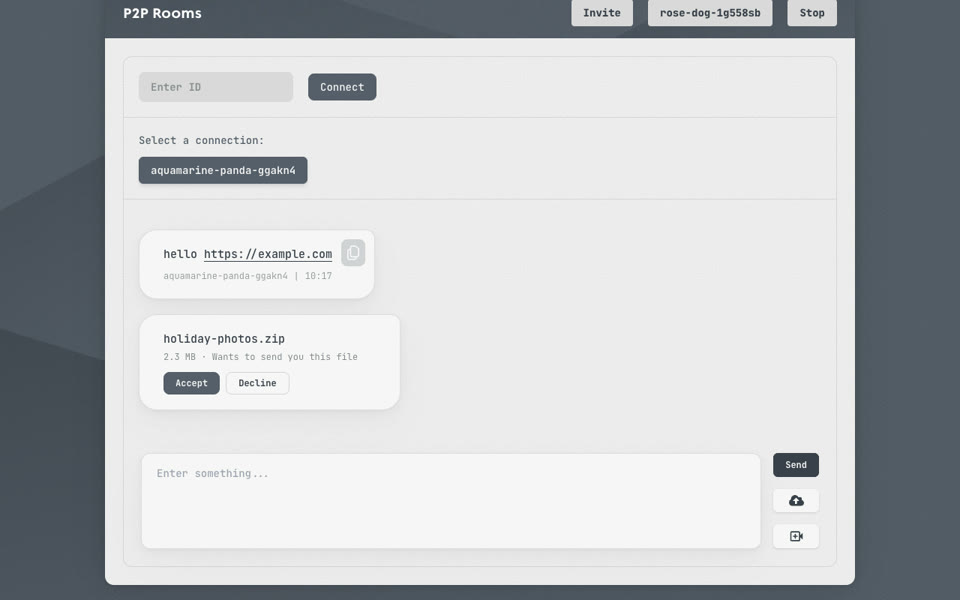
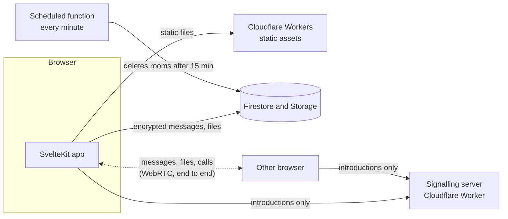

# ChatRooms

Private, temporary chat rooms for moving text and files between devices.
Open a room on one device, type its 6-character code on another, and
everything is deleted after 15 minutes. For direct device-to-device chat,
files and video calls, use a peer-to-peer room instead.

**[rooms.saklani.dev](https://rooms.saklani.dev)**


## Two kinds of rooms

|              | Rooms                                           | Peer-to-peer rooms                                 |
| ------------ | ----------------------------------------------- | -------------------------------------------------- |
| How it works | Messages go through Firebase                    | Browsers connect directly over WebRTC              |
| Devices      | Any number                                      | One connection per chat                            |
| History      | Kept for 15 minutes, then deleted               | None; nothing is stored                            |
| Messages     | Encrypted with a key derived from the room code | End-to-end encrypted by WebRTC                     |
| Files        | Up to 20 MB, not encrypted                      | Sent directly, only after the other person accepts |
| Extras       | Image previews, drag and drop, paste to upload  | Video calls, invite links and QR codes             |



## Performance

The site was rebuilt for speed while keeping its original design. Measured on
the home page with Lighthouse, mobile settings, median of 3 runs:

| Home page                                  | Before   | After  |
| ------------------------------------------ | -------- | ------ |
| Performance score (simulated)              | 79       | 98     |
| Performance score (real throttling)        | 74       | 100    |
| Largest Contentful Paint (real throttling) | 4.8 s    | 1.3 s  |
| Page weight                                | 1,208 KB | 145 KB |
| Requests                                   | 60       | 29     |
| JavaScript (compressed)                    | 202 KB   | 47 KB  |

"Before" is the previous live site. "After" was measured on a local build
served with compression, so expect some difference on the real CDN. CI
fails if a page drops below a performance score of 90 or grows past 260 KB.

What made the difference:

- The content renders immediately and CSS runs the entrance animation, where
  it used to wait on JavaScript behind a full-screen loader.
- Firebase, PeerJS and the QR code library load only when a page needs them,
  and the next page's code preloads on hover.
- GSAP, Firebase Analytics, Google Fonts and eight unused or replaceable
  packages are gone.
- The two background images went from 481 KB and 600 KB to 40 KB and 24 KB:
  a clean base image plus a small tile carrying the original grain.
- The CSS is inlined, the fonts are self-hosted and preloaded, and hashed
  assets are cached for a year.

## How it works



- **Frontend:** SvelteKit 3 and Svelte 5, prerendered and served as static
  files from Cloudflare Workers. Room links use a single-page fallback.
- **Rooms:** Firestore and Firebase Storage, behind security rules that only
  allow the exact reads and writes the app makes. A scheduled Firebase function
  deletes rooms, messages and files after 15 minutes.
- **Peer-to-peer:** a small PeerJS-compatible signalling server on a Cloudflare
  Durable Object. It only introduces browsers; everything after that flows
  directly between them. Heartbeats are answered without waking it, so it stays
  up for free.

## Security

- **Room messages** are encrypted in the browser with AES-GCM. The key and the
  room's ID are both derived from the room code with PBKDF2 (600,000
  iterations), so the database never sees the key. A 6-character code is still
  short: someone with a copy of the database could guess it, which is why rooms
  are not called end-to-end encrypted. Files are not encrypted.
- **Database rules** deny everything by default. Rooms can't be listed, writes
  need a valid shape and an anonymous sign-in, and expired rooms refuse new
  messages. Uploads are limited to 20 MB and can't overwrite each other.
- **Peer-to-peer** traffic is encrypted end to end by WebRTC. The signalling
  server sees peer IDs and connection details, never messages or files. Every
  connection, call and file needs the other person to accept, and the server
  sets each message's sender, so a peer can't pose as someone else.
- **The site** sends a strict Content Security Policy, loads no third-party
  scripts, and saves received files as plain downloads so they can't run in
  the site's origin.

## Running it locally

You need Node 24 (see `.node-version`), pnpm 10, and Java 21 for the Firebase
emulators. Node 25 and later break the Firebase CLI's deploy step, because one
of `firebase-admin`'s dependencies still uses `SlowBuffer`.

```bash
pnpm install
pnpm dev
```

Create a `.env` with your Firebase project and signalling server:

```bash
VITE_API_KEY=...
VITE_AUTH_DOMAIN=...
VITE_PROJECT_ID=...
VITE_STORAGE_BUCKET=...
VITE_SENDER_ID=...
VITE_APP_ID=...
VITE_PEERJS_HOST=127.0.0.1   # or your deployed signalling server
VITE_PEERJS_PORT=8787        # 443 for a deployed one
```

To run the signalling server locally: `cd signalling && npx wrangler dev`.

## Tests

| Command                            | What it checks                                                                                                         |
| ---------------------------------- | ---------------------------------------------------------------------------------------------------------------------- |
| `pnpm test`                        | Encryption and message link parsing                                                                                    |
| `pnpm test:rules`                  | Database and storage rules, and room cleanup, on the emulators                                                         |
| `pnpm test:signal`                 | The signalling server's protocol                                                                                       |
| `pnpm build:test && pnpm test:e2e` | 43 checks in Chrome: rooms, uploads, peer-to-peer chat, files, calls, layout on desktop and phones, performance guards |

CI runs all of them, plus type checks and a Lighthouse budget, on every push
and pull request.

## Deploying

- **Site:** a Cloudflare Worker connected to this repo, with build command
  `pnpm build`, deploy command `npx wrangler deploy`, and the `VITE_*`
  variables above as build variables. `wrangler.jsonc` serves `build/`.
- **Signalling server:** `cd signalling && npx wrangler deploy`. Add the site's
  address to `ALLOWED_ORIGINS` in `signalling/wrangler.jsonc`.
- **Firebase:** on Node 24, `npx firebase-tools deploy --only firestore:rules,storage,functions`.

## Built with

[SvelteKit](https://svelte.dev/docs/kit),
[Tailwind CSS](https://tailwindcss.com/),
[Firebase](https://firebase.google.com/),
[PeerJS](https://github.com/peers/peerjs),
[Cloudflare Workers](https://workers.cloudflare.com/).
